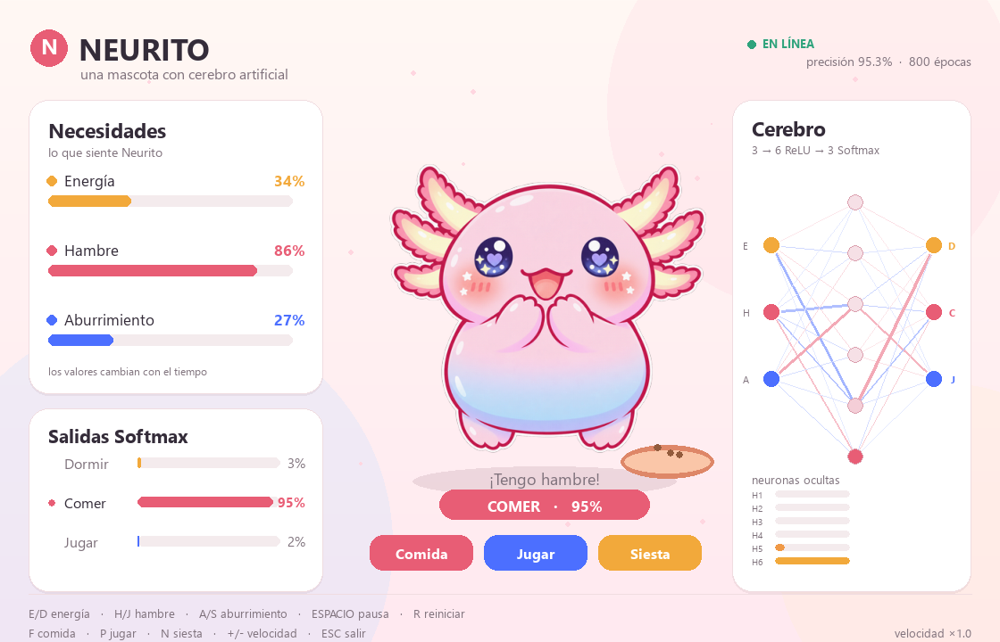
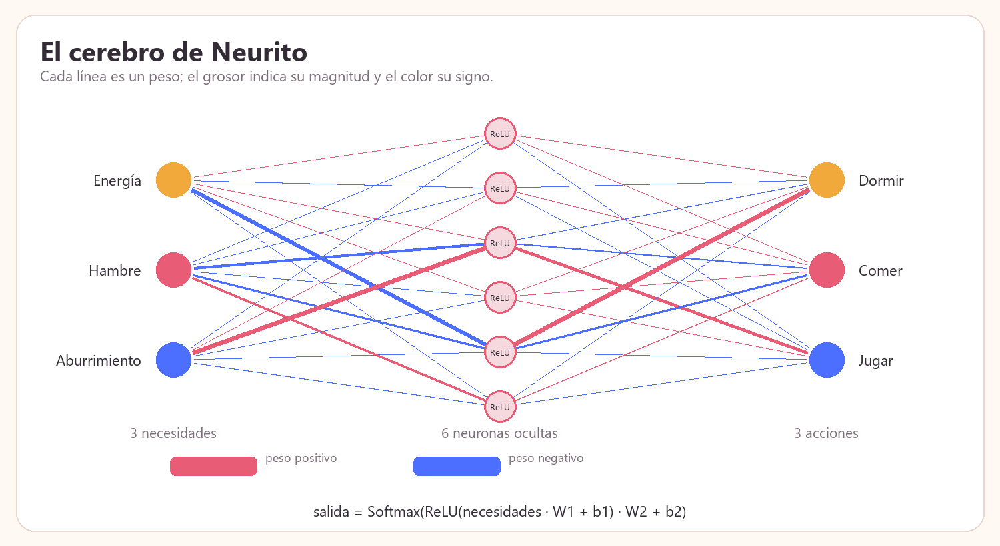
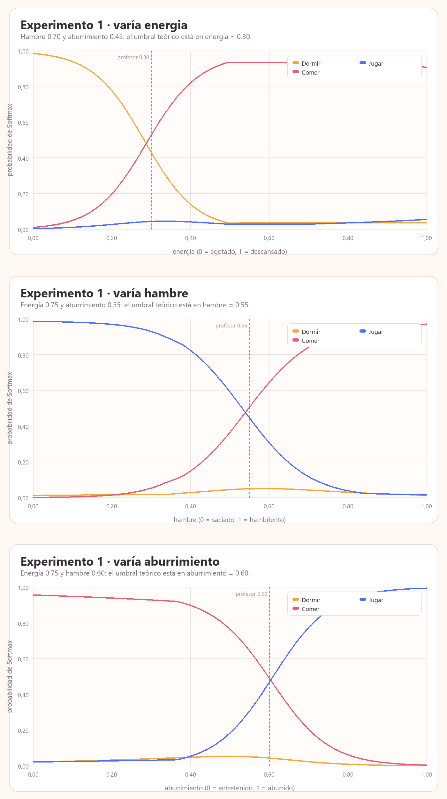
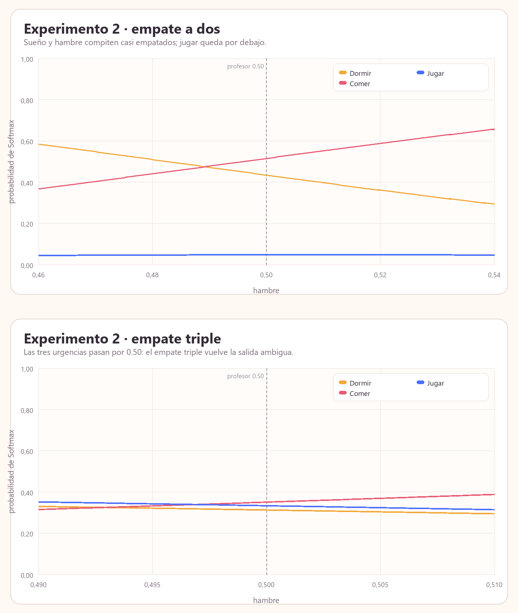
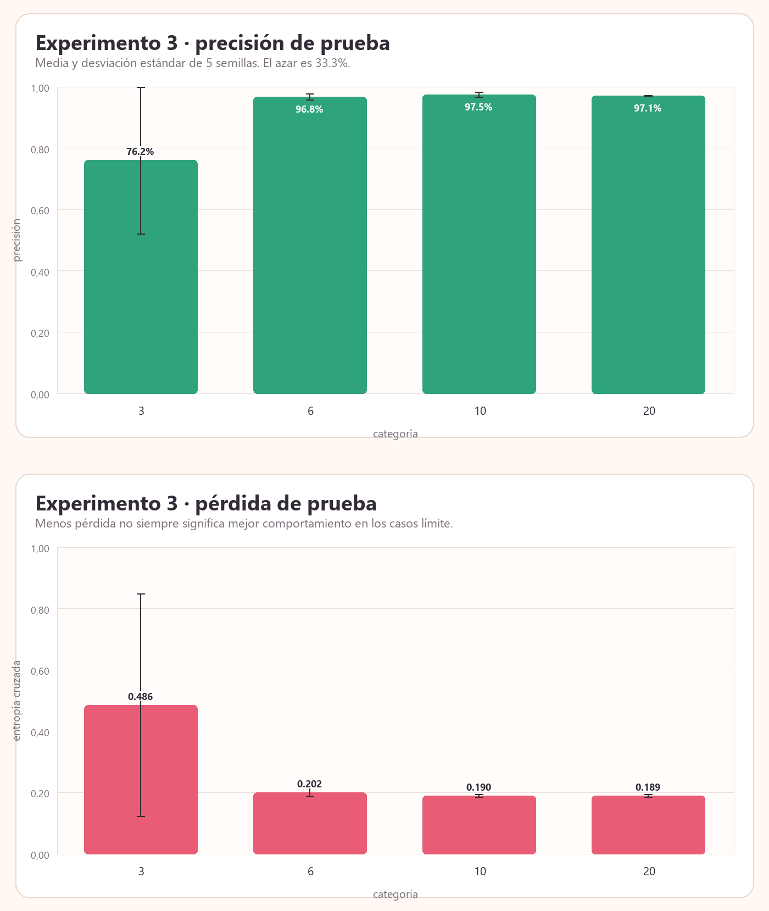
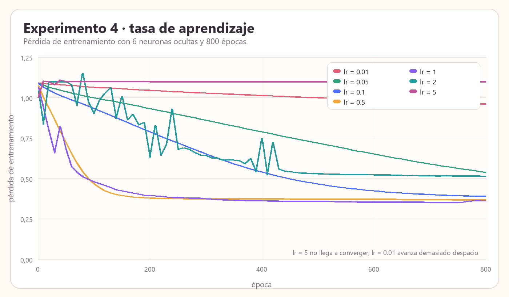
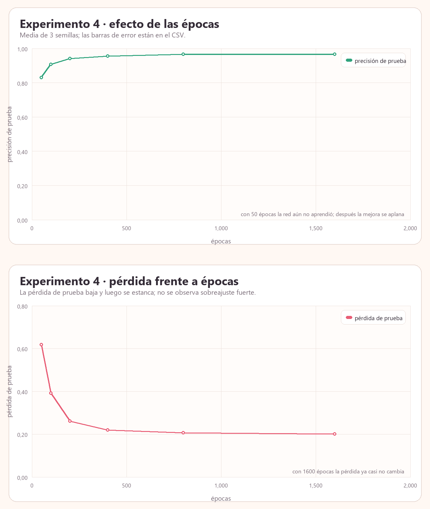
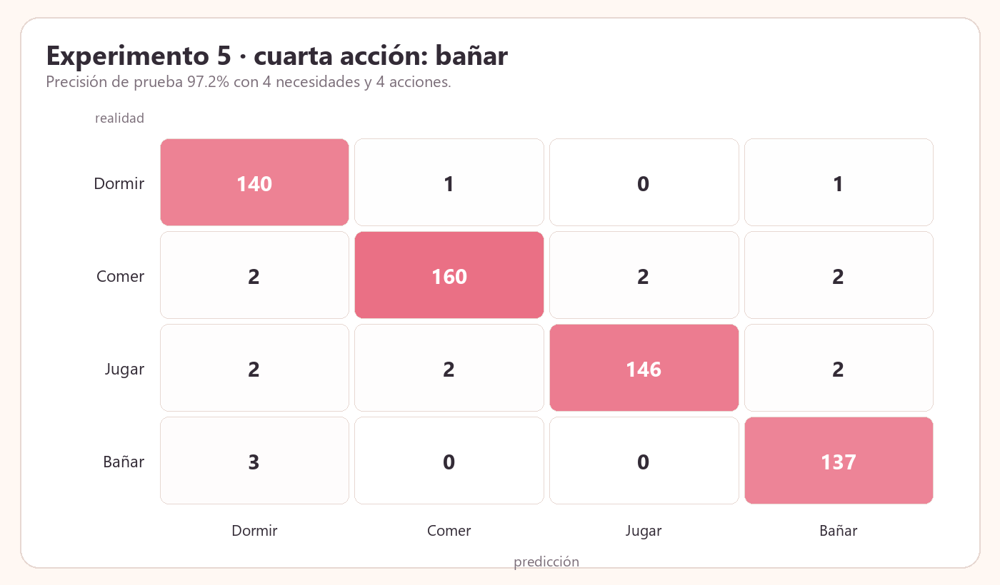
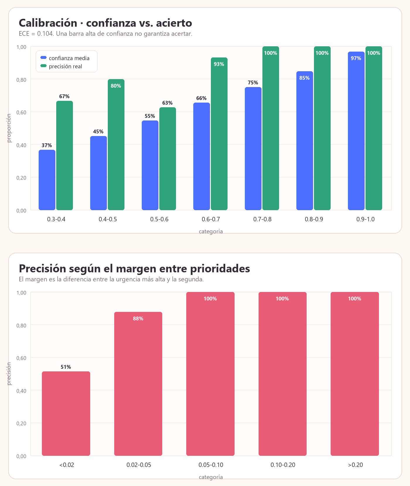

# Neurito: una mascota virtual con cerebro artificial

> Tres necesidades entran a una red neuronal. Una acción sale. La mascota la
> convierte en una animación, la acción cambia sus necesidades y el ciclo vuelve
> a empezar.

Neurito es un proyecto pequeño de inteligencia artificial: una red neuronal
implementada **desde cero con NumPy** que decide si la mascota debe **dormir,
comer o jugar**, y una mascota animada en **Pygame** que ejecuta esa decisión.

El proyecto incluye cinco experimentos, las tablas y gráficas que
salen de ejecutarlos y las respuestas conceptuales.



---

## 1. Qué se construyó

- Una red **3 → 6 (ReLU) → 3 (Softmax)** escrita solo con NumPy.
- Un profesor sintético que genera ejemplos a partir de tres necesidades.
- Entrenamiento con descenso de gradiente, entropía cruzada y regularización L2.
- Evaluación con precisión, pérdida, matriz de confusión, ECE y análisis de casos
  ambiguos.
- Una mascota animada en Pygame con:
  - barras de energía, hambre y aburrimiento;
  - visualización de la red y de las neuronas ocultas;
  - predicción en vivo y animaciones para dormir, comer y jugar;
  - botones para dar comida, jugar o mandar a dormir.
- Cinco experimentos reproducibles con CSV, JSON y gráficas.
- Pruebas unitarias del núcleo matemático, incluida una comprobación de
  gradientes por diferencias finitas.

---

## 2. Cómo ejecutarlo

### Requisitos

- Windows, Linux o macOS.
- **Python 3.12 o superior**.
- Las dependencias están en `requirements.txt` y en `pyproject.toml`:
  - `numpy`
  - `pygame-ce`
  - `pillow` (solo para preparar las ilustraciones y dibujar las gráficas)

### Opción A: con `uv` (la que usa el proyecto)

Desde la carpeta del proyecto:

```powershell
cd "tu_carpeta"
uv sync
```

`uv sync` crea/actualiza `.venv` con las versiones de `uv.lock`.

### Opción B: con `pip`

```powershell
cd "tu_carpeta"
python -m venv .venv
.\.venv\Scripts\Activate.ps1
python -m pip install --upgrade pip
pip install -r requirements.txt
```

Si PowerShell bloquea la activación del entorno, se puede ejecutar
`.\.venv\Scripts\python.exe` directamente, sin activar nada.

### Comandos principales

| Qué quieres hacer              | Comando                                                                                        |
| ------------------------------- | ---------------------------------------------------------------------------------------------- |
| Entrenar el cerebro             | `uv run python -m neurito.train`                                                             |
| Abrir la mascota                | `uv run python -m neurito`                                                                   |
| Abrir la mascota (forma larga)  | `uv run python -m neurito.pet`                                                               |
| Ejecutar los cinco experimentos | `uv run python -m neurito.experiments`                                                       |
| Ejecutar las pruebas            | `uv run python -m unittest discover -s tests -v`                                             |
| Probar la mascota sin ventana   | `uv run python -m neurito.pet --headless --frames 150 --screenshot docs/neurito_preview.png` |

Sin `uv`, reemplaza `uv run python` por `python` con el entorno activado.

La primera vez que se abre la mascota, si no existe `models/neurito.npz`, el
programa entrena el modelo automáticamente y lo guarda. El archivo del modelo es
pequeño (unos pocos KB) y está ignorado por Git porque se puede regenerar.

---

## 3. Controles de la mascota

| Tecla         | Acción                     |
| ------------- | --------------------------- |
| `E` / `D` | Subir / bajar energía      |
| `H` / `J` | Subir / bajar hambre        |
| `A` / `S` | Subir / bajar aburrimiento  |
| `F`         | Dar comida                  |
| `P`         | Jugar con Neurito           |
| `N`         | Mandarlo a dormir           |
| `Espacio`   | Pausa                       |
| `R`         | Reiniciar                   |
| `+` / `-` | Acelerar / frenar el tiempo |
| `Esc`       | Salir                       |

También se puede hacer clic en los botones **Comida**, **Jugar** y **Siesta**.
Esos botones no fuerzan la acción de la red: cambian las necesidades, y la red
vuelve a decidir. Esa es la diferencia entre “guionizar” a la mascota y dejar
que su cerebro tome la decisión.

---

## 4. Cómo funciona el cerebro

### 4.1 Las tres necesidades

| Necesidad        | Significado            | 0           | 1          |
| ---------------- | ---------------------- | ----------- | ---------- |
| `energia`      | Cuánta energía tiene | Agotado     | Descansado |
| `hambre`       | Cuánta hambre tiene   | Saciado     | Hambriento |
| `aburrimiento` | Cuánto se aburre      | Entretenido | Aburrido   |

Se definen tres **urgencias**:

```text
urgencia_dormir = 1 - energia
urgencia_comer  = hambre
urgencia_jugar  = aburrimiento
```

La acción correcta es la de mayor urgencia. Si hay un empate exacto, el profesor
elige en el orden `dormir > comer > jugar`; es una convención, no una verdad
universal. Esa convención será importante en el experimento 2.

### 4.2 La red

```text
x = [energia, hambre, aburrimiento]        (3 entradas)

h = ReLU(x · W1 + b1)                     (6 neuronas ocultas)
z = h · W2 + b2                           (3 logits)
p = Softmax(z)                            (3 probabilidades)
```

Formas de los parámetros:

| Parámetro      |  Forma |     Cantidad |
| --------------- | -----: | -----------: |
| `W1`          | 3 × 6 |           18 |
| `b1`          | 1 × 6 |            6 |
| `W2`          | 6 × 3 |           18 |
| `b2`          | 1 × 3 |            3 |
| **Total** |        | **45** |



La pérdida que se minimiza es la entropía cruzada media, con un pequeño término
L2 sobre las matrices de pesos:

```text
L = -(1/N) · Σ log(p[y]) + (λ/2) · (||W1||² + ||W2||²)
```

El descenso de gradiente actualiza todos los parámetros en la dirección
contraria al gradiente:

```text
θ ← θ - α · ∂L/∂θ
```

La retropropagación está escrita a mano en `neurito/brain.py`. Para softmax +
entropía cruzada, el gradiente respecto de los logits es simplemente
`p - onehot(y)`; a partir de ahí se aplica la regla de la cadena.

### 4.3 Datos y etiquetas

Se generan **3000 ejemplos** con las tres necesidades uniformes en `[0, 1]`.
Se separan en:

- 2100 para entrenamiento,
- 450 para validación,
- 450 para prueba.

Las etiquetas de entrenamiento tienen un **5 % de ruido**: en el 5 % de los
casos se cambia la acción por otra. La idea es simular a un cuidador que a veces
se equivoca o a una mascota que no siempre reacciona igual. Validación y prueba
conservan la política limpia, así que miden lo que la red aprendió, no cuánto
memorizó el ruido.

El ruido también evita el problema de un proyecto de juguete con 100 % de
precisión: obliga a mirar la pérdida, la calibración y los casos límite.

### 4.4 De la predicción a la animación

En `neurito/pet.py`:

1. Cada 0.12 s se llama a `model.forward(necesidades)`.
2. Se obtienen las tres probabilidades Softmax y la activación de las seis
   neuronas ocultas.
3. La acción con mayor probabilidad se convierte en la acción actual, con un
   pequeño retardo de 0.35 s para evitar parpadeos cerca de una frontera.
4. La animación correspondiente se reproduce.
5. La acción modifica las necesidades:
   - dormir recupera energía;
   - comer baja el hambre;
   - jugar baja el aburrimiento y gasta energía.
6. Las necesidades cambian, la red vuelve a predecir y el ciclo continúa.

La mascota no tiene un guion de acciones: la animación es la salida visible de
la red.

---

## 5. Experimentos

Todos los resultados se generan con:

```powershell
uv run python -m neurito.experiments
```

Los archivos completos quedan en `results/` y las gráficas en `docs/`. El
resumen automático está en [`results/RESULTADOS.md`](results/RESULTADOS.md).

### 5.1 Experimento 1: dos necesidades fijas y una variable

Se fijaron dos necesidades y se barrió la tercera de 0 a 1 en pasos de 0.001.
La pregunta es **en qué punto cambia la acción predicha**.

| Variable         | Necesidades fijas                    | Acción antes → después | Umbral teórico | Umbral de la red | Diferencia |
| ---------------- | ------------------------------------ | ------------------------- | --------------: | ---------------: | ---------: |
| `energia`      | hambre = 0.70, aburrimiento = 0.45   | dormir → comer           |           0.300 |            0.287 |    −0.013 |
| `hambre`       | energía = 0.75, aburrimiento = 0.55 | jugar → comer            |           0.550 |            0.539 |    −0.010 |
| `aburrimiento` | energía = 0.75, hambre = 0.60       | comer → jugar            |           0.600 |            0.604 |     +0.003 |

> El barrido usa pasos de 0.001, así que el cruce medido del profesor queda en el
> punto medio entre las dos muestras vecinas (0.3005, 0.5495 y 0.6005). En la
> tabla se muestra el valor exacto de la regla para poder compararlo.



La regla es siempre la misma: **la acción cambia cuando la urgencia de la
variable supera a la mayor de las dos urgencias fijas**.

- Energía: como su urgencia es `1 - energia`, el umbral es
  `energia* = 1 - max(hambre, aburrimiento) = 1 - 0.70 = 0.30`.
- Hambre: `hambre* = max(1 - energía, aburrimiento) = max(0.25, 0.55) = 0.55`.
- Aburrimiento: `aburrimiento* = max(1 - energía, hambre) = max(0.25, 0.60) = 0.60`.

La red aprendió los tres umbrales con un error máximo de **0.013** (1.3 puntos
porcentuales de la escala). No son exactamente iguales a los del profesor porque
la red ve ejemplos con ruido y aproxima la frontera con solo 6 neuronas.

### 5.2 Experimento 2: prioridades casi iguales y Softmax

Se colocaron dos o tres urgencias alrededor de 0.50 y se movió el hambre muy
poco, en pasos de 0.0005.

| Caso          | `p(dormir)` | `p(comer)` | `p(jugar)` |       Entropía | Acción de la red |
| ------------- | ------------: | -----------: | -----------: | --------------: | ----------------- |
| Empate a dos  |         0.435 |        0.516 |        0.049 |           0.851 | comer             |
| Empate triple |         0.314 |        0.352 |        0.335 | **1.098** | comer             |

Al mover el hambre un poco alrededor del empate:

| Caso             | Hambre | `p(dormir)` | `p(comer)` | `p(jugar)` | Acción |
| ---------------- | -----: | ------------: | -----------: | -----------: | ------- |
| Dos prioridades  |  0.480 |         0.511 |        0.441 |        0.048 | dormir  |
| Dos prioridades  |  0.500 |         0.435 |        0.516 |        0.049 | comer   |
| Dos prioridades  |  0.520 |         0.362 |        0.589 |        0.049 | comer   |
| Tres prioridades |  0.490 |         0.331 |        0.316 |        0.353 | jugar   |
| Tres prioridades |  0.500 |         0.314 |        0.352 |        0.335 | comer   |
| Tres prioridades |  0.510 |         0.296 |        0.389 |        0.315 | comer   |



Lectura:

- En el empate a dos, dormir y comer se reparten casi todo (`0.435` y `0.516`),
  mientras jugar queda en `0.049`. La decisión es frágil: con hambre = 0.48 la
  red elige dormir; con hambre = 0.49 ya elige comer.
- En el empate triple, las tres probabilidades son casi `1/3` y la entropía es
  `1.098`, prácticamente el máximo posible `ln(3) = 1.099`. La red no tiene una
  razón fuerte para elegir; su pequeña diferencia aprendida hace que se incline
  por comer, pero el margen es mínimo.
- Softmax es **suave**: las probabilidades cambian de forma continua. El
  `argmax` es **discreto**: un cambio minúsculo de la entrada puede cambiar la
  acción. Cerca del empate, las dos cosas conviven.
- Las salidas siempre suman 1. No son probabilidades “reales” garantizadas: si
  el modelo está mal calibrado, pueden ser confianza mal expresada.
- En el empate triple exacto, el profesor rompe el empate a favor de dormir,
  pero la red elige comer por 0.038 de diferencia. Eso no es un error grave: es
  la consecuencia de que un empate exacto no tiene una respuesta única y de que
  la política de desempate del profesor es arbitraria. Es una buena lección:
  **hay que definir qué hacer con los empates antes de evaluar**.

### 5.3 Experimento 3: 3, 6, 10 y 20 neuronas ocultas

Se entrenaron cinco semillas por cada tamaño, con los mismos datos, 800 épocas,
tasa de aprendizaje 0.5 y ruido de etiquetas del 5 %.

| Neuronas | Parámetros | Precisión de prueba (media ± desv.) |          Rango |       Pérdida de prueba | Precisión en ambiguos |
| -------: | ----------: | ------------------------------------: | -------------: | -----------------------: | ---------------------: |
|        3 |          24 |                     76.2 % ± 24.1 pp | 37.6 – 95.8 % |           0.486 ± 0.362 |                 56.2 % |
|        6 |          45 |                      96.8 % ± 1.0 pp | 95.1 – 98.0 % |           0.202 ± 0.014 |                 78.8 % |
|       10 |          73 |            **97.5 % ± 0.7 pp** | 96.4 – 98.7 % |           0.190 ± 0.005 |       **83.5 %** |
|       20 |         143 |                      97.1 % ± 0.1 pp | 96.9 – 97.3 % | **0.189** ± 0.005 |                 80.9 % |



> El modelo de la mascota usa la semilla 42 y obtuvo 95.3 % de precisión; la
> media de 6 neuronas con cinco semillas distintas es 96.8 %. No es una
> contradicción: la inicialización cambia el resultado en uno o dos puntos
> porcentuales, sobre todo con un test de 450 ejemplos. Por eso el experimento
> reporta media, desviación y rango, no un solo número.

Interpretación:

- **3 neuronas no solo tienen menos capacidad: son inestables.** Dos de las
  cinco semillas quedaron atrapadas alrededor de 38 % y 58 % de precisión, muy
  cerca del azar (33.3 %). Probablemente varias ReLU murieron y la red se quedó
  en una zona plana. La mediana fue 94.2 %, pero la media y la desviación
  estándar cuentan la historia completa: con muy poca capacidad, el resultado
  depende mucho de la inicialización.
- **6 neuronas ya son suficientes** para este problema: 45 parámetros y 96.8 %
  de media. Es la opción de la mascota por ser pequeña y rápida.
- **10 neuronas dan la mejor media** (97.5 %) y la mejor precisión en casos
  ambiguos (83.5 %), con solo 73 parámetros.
- **20 neuronas no mejoran**: la pérdida baja apenas 0.001 y la precisión media
  baja un poco (97.1 %). Son 143 parámetros para una mejora que no se nota. Es
  un ejemplo de rendimientos decrecientes.
- El paso de 6 a 10 mejora, el de 10 a 20 no. La pregunta no es “¿cuál es la red
  más grande?”, sino “¿cuál es la red más pequeña que resuelve el problema?”.

### 5.4 Experimento 4: épocas y tasa de aprendizaje

Primero se fijaron 800 épocas y se cambió la tasa de aprendizaje (`lr`). Después
se fijó `lr = 0.5` y se cambiaron las épocas.

| `lr` | Precisión de prueba | Pérdida de prueba | Estado                        |
| -----: | -------------------: | -----------------: | ----------------------------- |
|   0.01 |               61.3 % |              0.912 | se estanca                    |
|   0.05 |               90.2 % |              0.454 | se estanca                    |
|    0.1 |     **96.7 %** |              0.255 | mejora                        |
|    0.5 |               95.3 % |              0.195 | mejora                        |
|    1.0 |               94.7 % |              0.185 | mejora                        |
|    2.0 |               83.3 % |              0.350 | se estanca en un mínimo peor |
|    5.0 |               37.6 % |              1.097 | inestable / colapsa           |



- `lr = 0.01` avanza demasiado despacio: en 800 épocas todavía está lejos.
- `lr = 0.1`, `0.5` y `1.0` funcionan bien. `0.1` gana por poco en esta semilla;
  la diferencia con `0.5` no es concluyente con 450 ejemplos de prueba.
- `lr = 2.0` no diverge a `NaN`, pero se queda en un mínimo peor: 83.3 %.
- `lr = 5.0` sí es inestable en el sentido práctico: la pérdida se queda en
  `ln(3) ≈ 1.099`, la red predice casi uniforme y acierta 37.6 %, prácticamente
  el azar. Los pasos son tan grandes que la red no logra aprender.

| Épocas | Precisión media (3 semillas) | Pérdida media |
| ------: | ----------------------------: | -------------: |
|      50 |                        83.1 % |          0.618 |
|     100 |                        90.8 % |          0.392 |
|     200 |                        94.2 % |          0.261 |
|     400 |                        95.6 % |          0.220 |
|     800 |              **96.7 %** |          0.207 |
|    1600 |                        96.7 % |          0.201 |



El entrenamiento **mejora** hasta unas 400–800 épocas y luego **se estanca**.
Pasar a 1600 épocas no mejora la precisión media y solo baja un poco la pérdida;
no se ve un sobreajuste fuerte, en parte por el ruido y la regularización L2.
Con 450 ejemplos de prueba, una diferencia de 1 punto porcentual es ruido, no
una conclusión.

### 5.5 Experimento 5: ¿qué haría falta para una cuarta acción?

La cuarta acción elegida fue **bañar**. Para que sea una decisión con sentido
hay que añadir una cuarta necesidad: **suciedad**.

```text
x = [energia, hambre, aburrimiento, suciedad]
urgencias = [1 - energia, hambre, aburrimiento, suciedad]
acciones = [dormir, comer, jugar, bañar]
```

Se generaron 4000 ejemplos (2800 / 600 / 600), se entrenó una red
**4 → 10 (ReLU) → 4 (Softmax)** y se obtuvo:

- 94 parámetros;
- precisión de prueba **97.2 %**;
- pérdida de prueba 0.233;
- recall por clase: dormir 98.6 %, comer 96.4 %, jugar 96.1 %, bañar 97.9 %.



Lo que se necesitaría para llevarlo a la mascota real:

1. **Una entrada nueva**: `suciedad` (0 = limpio, 1 = muy sucio).
2. **Una salida nueva** en la capa final y, probablemente, más capacidad en la
   capa oculta. La capa de salida pasa de 3 a 4 neuronas: hay que volver a
   entrenar, no se puede reciclar el modelo anterior sin tocar la última capa.
3. **Etiquetas para las cuatro acciones**. No basta con “inventar” la acción:
   cada fila debe tener las cuatro necesidades y una etiqueta entre cuatro
   clases. Si no se añade la necesidad de suciedad, habrá combinaciones de
   entrada idénticas con etiquetas distintas (`jugar` y `bañar`), y el problema
   será ambiguo por diseño.
4. **Ejemplos equilibrados y casos límite**: no solo situaciones obvias, también
   donde la higiene compita cerca con el sueño, el hambre o el aburrimiento.
5. **Dinámica nueva en la mascota**: la suciedad sube con el tiempo; bañar la
   baja; hace falta una animación y un botón.
6. **Volver a evaluar**: precisión por clase, matriz de confusión y calibración.
   Un 97 % global puede esconder una clase mala; en este caso todas las clases
   quedaron por encima del 96 % de recall.

En un proyecto real las etiquetas no saldrían de una fórmula: se obtendrían de
decisiones de cuidadores, de registros de uso o de demostraciones. Eso hace que
el problema sea más difícil y que la calidad de los datos importe tanto como la
red.

---

## 6. Respuestas conceptuales

### 6.1 ¿En qué se diferencian los pesos y los sesgos?

En una capa, la salida se calcula como:

```text
z = x · W + b
```

- Los **pesos** (`W`) multiplican a las entradas. Deciden **cuánto importa cada
  necesidad** y con qué signo. Un peso positivo sobre `hambre` hace que más
  hambre empuje la neurona hacia arriba; un peso negativo la empuja hacia abajo.
- Los **sesgos** (`b`) son un desplazamiento propio de cada neurona. No
  multiplican ninguna entrada: **mueven el umbral** de activación. Sin sesgo, la
  frontera de decisión de una neurona pasa por el origen; con sesgo, se desplaza.
- Los dos se entrenan con descenso de gradiente, pero el sesgo permite que una
  neurona se active incluso cuando todas las entradas son cero, o que sea más
  difícil de activar. Los pesos dicen “qué combinación de entradas importa”; el
  sesgo dice “qué tan fácil es que esta neurona se encienda”.
- En Neurito, `W1` mezcla las tres necesidades en las seis neuronas ocultas y
  `b1` ajusta cuándo se encienden. `W2` mezcla las activaciones ocultas en las
  tres acciones y `b2` da una preferencia base por cada acción.
- La regularización L2 se aplica a los pesos, no a los sesgos. Tiene sentido:
  queremos evitar que una conexión crezca demasiado, pero un sesgo grande puede
  ser necesario para desplazar una frontera.

### 6.2 ¿Por qué el cansancio es `1 - energía`?

Porque la energía y el cansancio son dos caras de la misma escala:

| Energía | Cansancio = 1 − energía |
| -------: | ------------------------: |
|      1.0 |                       0.0 |
|      0.8 |                       0.2 |
|      0.5 |                       0.5 |
|      0.2 |                       0.8 |
|      0.0 |                       1.0 |

Así, **todas las urgencias se leen igual**: más grande = más urgente. Si
usáramos la energía directamente, una energía baja debería significar “dormir”,
pero `argmax` elegiría lo contrario. Podríamos usar `-energía`, pero entonces
las urgencias no estarían en la misma escala y sería más difícil compararlas.
`1 - energía` normaliza el cansancio en `[0, 1]` y hace que el profesor sea una
simple comparación de tres números.

Es una **decisión de modelado**, no una ley física. Se podría usar
`(1 - energía)²` para que el cansancio explote solo cuando la energía es muy
baja, o una función con histéresis. Lo importante es que la transformación sea
monótona y que su significado sea claro.

### 6.3 ¿Qué hace ReLU y qué hace Softmax?

**ReLU** (`Rectified Linear Unit`):

```text
ReLU(z) = max(0, z)
```

- Deja pasar los valores positivos y convierte los negativos en cero.
- Aporta **no linealidad**. Sin ella, apilar capas sería equivalente a una sola
  transformación lineal, y la red no podría aprender fronteras curvas.
- Es barata de calcular y produce activaciones dispersas (muchas neuronas en 0).
- Tiene un riesgo: una neurona puede quedarse “muerta” si su gradiente se vuelve
  cero para siempre. Eso es lo que probablemente le pasó a algunas semillas de
  3 neuronas en el experimento 3.

**Softmax**:

```text
Softmax(z_i) = exp(z_i) / Σ_j exp(z_j)
```

- Convierte los tres logits en tres probabilidades positivas que suman 1.
- Conserva el orden: la acción con mayor logit sigue siendo la de mayor
  probabilidad.
- Es una generalización de la sigmoide para varias clases.
- No es un medidor de verdad absoluto: si el modelo está mal calibrado, puede
  decir 0.95 cuando acierta mucho menos. Por eso se mide el ECE.
- En la implementación se resta el máximo de los logits antes de exponenciar
  para evitar desbordamientos numéricos; el resultado matemático es el mismo.

En resumen: **ReLU decide qué neuronas se encienden; Softmax decide cómo se
reparte la culpa/confianza entre las acciones**.

### 6.4 ¿Por qué una precisión alta puede ser engañosa?

Porque un solo número resume muchos tipos de error y puede esconder lo que más
importa. En este proyecto hay varias evidencias:

1. **El modelo acierta el 95.3 % global, pero en los casos casi empatados
   acierta solo el 69.1 %.** El 15.1 % del test está en esa zona. Si la mascota
   se equivoca justo cuando dos necesidades compiten, el usuario lo nota mucho
   más que los aciertos fáciles.
2. **Con un margen menor que 0.02, la precisión baja al 51.4 %** (35 casos).
   Con margen entre 0.02 y 0.05 sube a 87.9 %; por encima de 0.05, en este test,
   acierta el 100 %. La precisión global es un promedio que mezcla casos fáciles
   y casos límite.
3. **El ECE es 0.104.** La confianza media no coincide del todo con la
   frecuencia real de acierto. Un modelo puede ser muy preciso en promedio y, a
   la vez, estar mal calibrado.


4. **El desbalance de clases es una trampa clásica.** Si el 80 % de los casos
   fueran “comer”, un clasificador que siempre dijera “comer” tendría 80 % de
   precisión y 0 % de recall en las otras dos clases; su precisión balanceada
   sería 33.3 %. La precisión global se ve bien, pero el modelo es inútil para
   las clases minoritarias.
5. **El test es pequeño (450 ejemplos).** Una diferencia de 1–2 puntos
   porcentuales puede ser ruido de muestreo. Además, el modelo se evaluó con la
   política sintética limpia; en una mascota real la distribución cambiaría.
6. **El 5 % de ruido en las etiquetas de entrenamiento** pone un techo práctico
   a la precisión: no tiene sentido perseguir 100 % si las etiquetas mismas son
   imperfectas.

Por eso, además de la precisión, el README reporta **pérdida, matriz de
confusión, recall por clase, precisión balanceada, ECE y precisión por margen**.
Una métrica sola nunca cuenta toda la historia.

---

## 7. Pruebas y reproducibilidad

```powershell
uv run python -m unittest discover -s tests -v
```

Las pruebas cubren:

- Softmax: suma 1, invariancia a desplazamientos y estabilidad con logits
  grandes.
- Gradientes: comparación con diferencias finitas para `W1`, `b1`, `W2` y `b2`.
- Profesor: casos conocidos y desempates.
- Datos: reproducibilidad y particiones disjuntas.
- Persistencia: guardar y cargar el modelo.
- Métricas: matriz de confusión y ECE.

También se puede probar la interfaz sin abrir una ventana:

```powershell
uv run python -m neurito.pet --headless --frames 150 --screenshot docs/neurito_preview.png
```

Todo el proyecto usa semillas fijas. Los resultados pueden variar ligeramente
entre versiones de NumPy por el orden de las operaciones en punto flotante, pero
las conclusiones se mantienen.

---

## 8. Estructura del repositorio

```text
neurito/
├─ neurito/
│  ├─ __init__.py
│  ├─ __main__.py       # atajo: python -m neurito
│  ├─ brain.py          # red, ReLU, Softmax, guardar/cargar
│  ├─ data.py           # profesor, datos, ruido, cuarta acción
│  ├─ train.py          # entrenamiento, evaluación, CLI
│  ├─ metrics.py        # confusión, ECE, márgenes, precisión balanceada
│  ├─ plots.py          # gráficas con Pillow
│  ├─ experiments.py    # los cinco experimentos
│  └─ pet.py            # mascota animada en Pygame
├─ tests/
│  └─ test_brain.py
├─ tools/
│  └─ prepare_assets.py # recorta y optimiza las ilustraciones
├─ assets/
│  ├─ pet/              # PNG optimizados que usa la mascota
│  └─ *.png             # originales pesados
├─ models/              # modelo entrenado (ignorado; se regenera)
├─ results/             # CSV, JSON y PNG de los experimentos
├─ docs/                # figuras del README y captura de la mascota
├─ main.py              # versión original de una sola pantalla (referencia)
├─ pyproject.toml
├─ requirements.txt
├─ uv.lock
└─ README.md
```

Los originales de las ilustraciones pesan alrededor de 10.7 MB. El script
`tools/prepare_assets.py` genera copias de 512 × 512 en `assets/pet/` (1.8 MB en
total). El repositorio usa las copias optimizadas; los originales quedan
ignorados para no inflar Git.

---

## 9. Limitaciones y siguientes pasos

Este proyecto es deliberadamente pequeño y didáctico. Sus límites:

- Los datos son sintéticos y el profesor es una regla, no una mascota real.
- La red no tiene memoria temporal: decide con las necesidades de ese instante.
- No hay aprendizaje por refuerzo; la mascota no aprende de sus errores.
- La animación es una capa visual, no una simulación física.
- La calibración es mejorable (ECE ≈ 0.104).
- El test tiene 450 ejemplos; las diferencias de 1–2 puntos porcentuales no son
  concluyentes.

Ideas para continuar:

1. Añadir la necesidad de higiene y la acción de bañar (el experimento 5 ya
   muestra el camino).
2. Reemplazar el profesor por etiquetas de usuarios reales.
3. Añadir memoria (por ejemplo, una RNN pequeña) para que el estado de ánimo
   dependa del historial.
4. Usar aprendizaje por refuerzo para que la mascota aprenda qué acción la
   mantiene más feliz a largo plazo.
5. Calibrar las probabilidades con temperature scaling y volver a medir el ECE.
6. Añadir más acciones y comprobar si la precisión por clase se mantiene.

---

## 10. Créditos

- Código, datos sintéticos, experimentos y README: proyecto académico de
  Neurito.
- Ilustraciones de la mascota: incluidas en `assets/` y optimizadas para el
  repositorio.
- Construido con NumPy, Pygame-ce y Pillow.

Si usas este proyecto como base, conserva la atribución y adapta las respuestas
a tus propios resultados.
